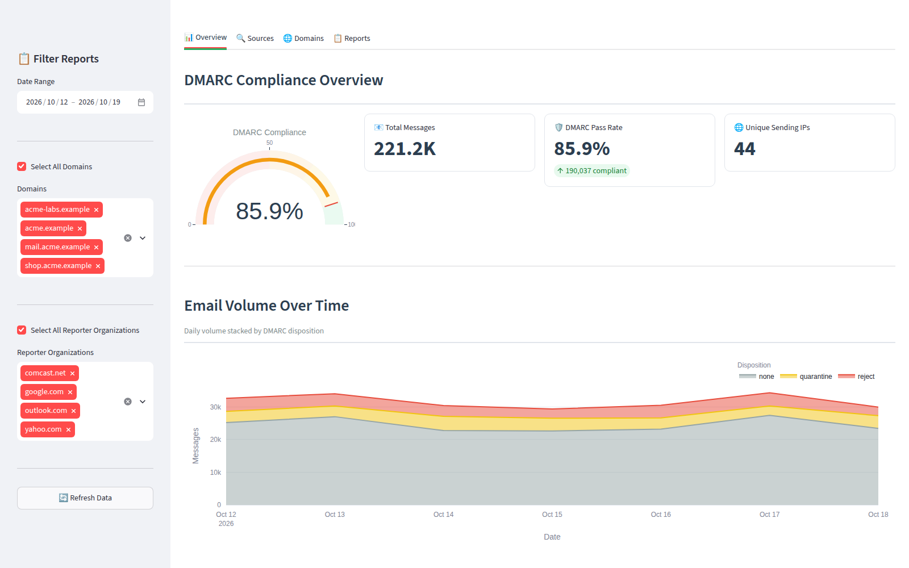
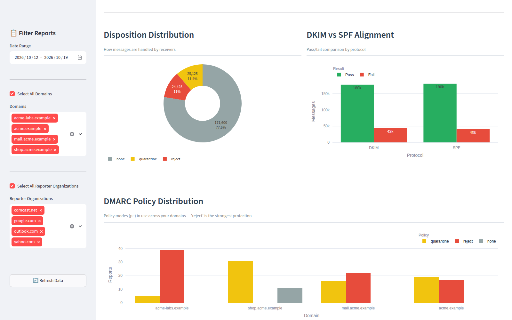
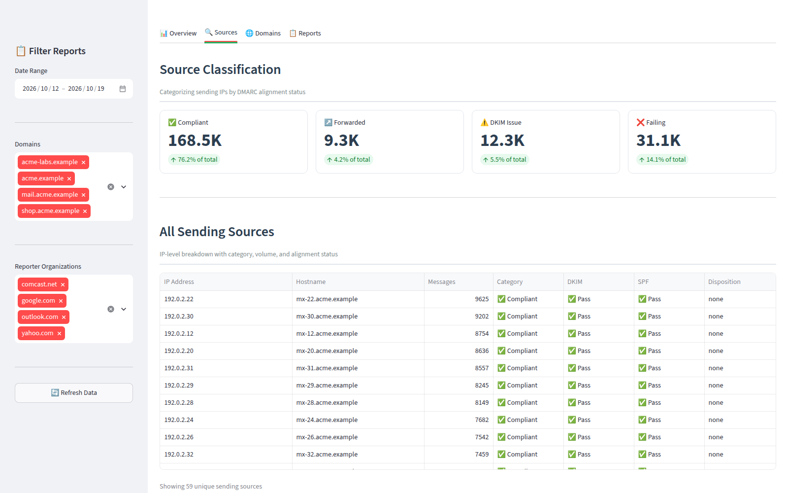
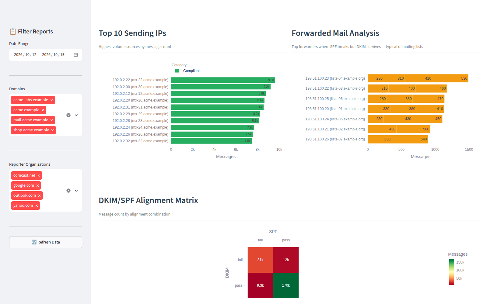
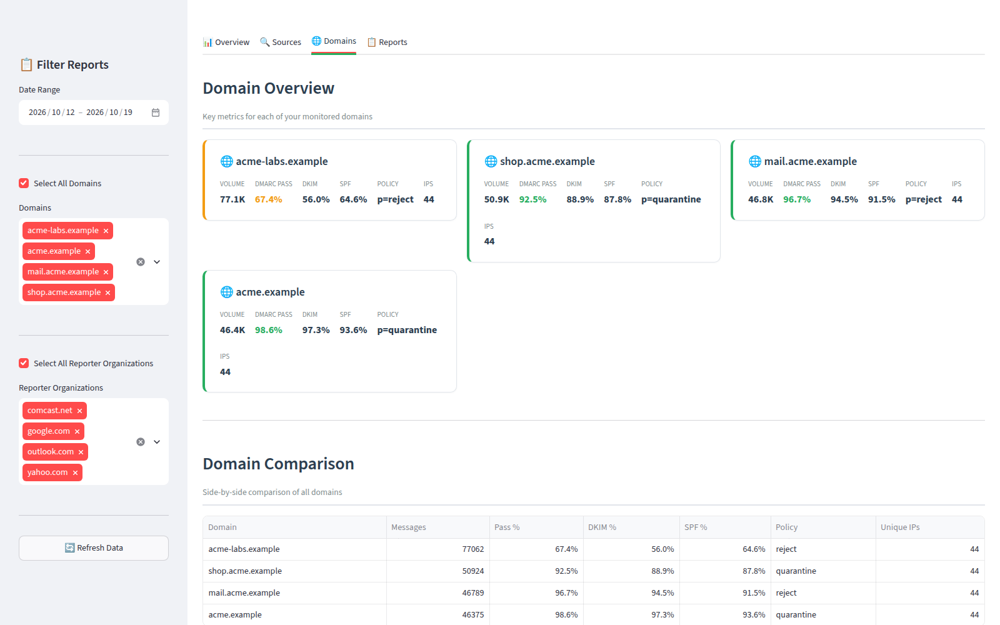
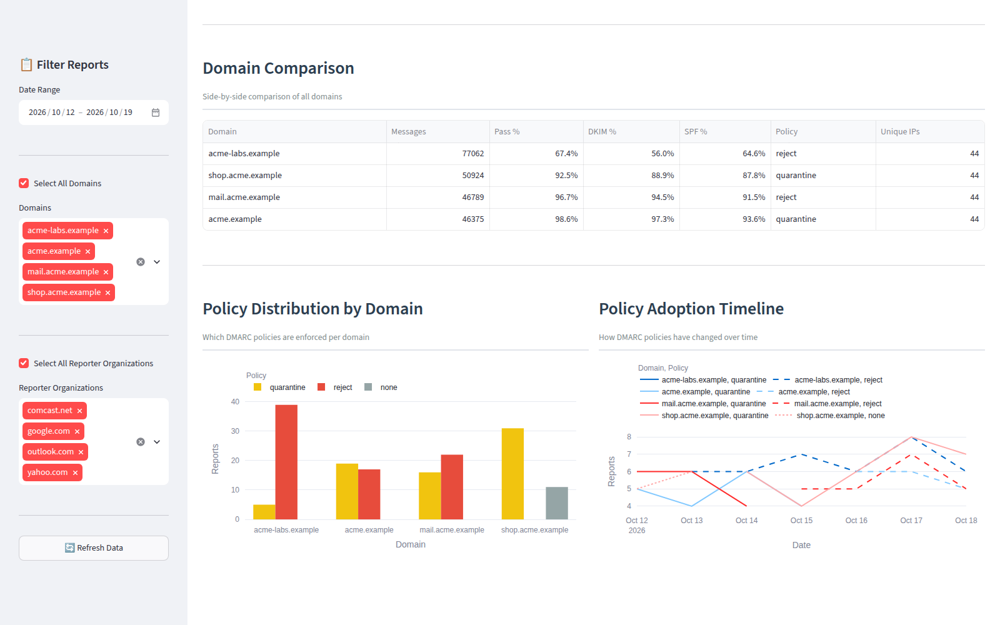
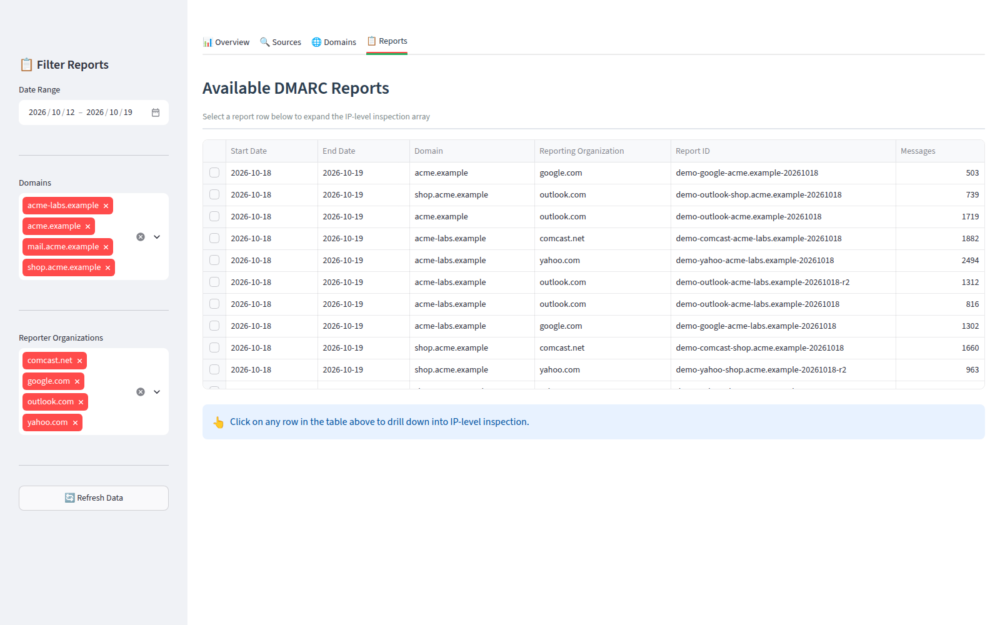
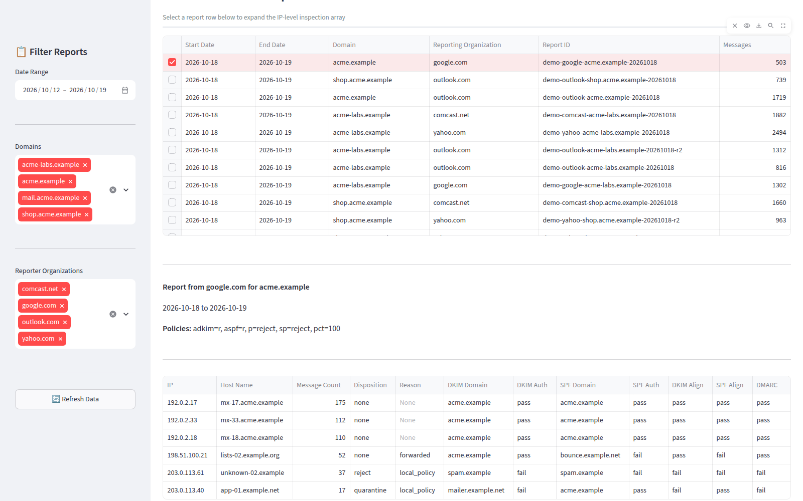

# DMARClyzer

🛡️ **Modern DMARC Aggregate Report Analyzer**

A unified, robust Python + Streamlit dashboard for ingesting, parsing, and visualizing DMARC aggregate reports — inspired by the dmarcian.com experience. Connects to your own MariaDB instance.

<!-- buttons -->
[](https://github.com/ivancarlosti/dmarclyzer/stargazers)
[](https://github.com/sponsors/ivancarlosti)
[](https://github.com/sponsors/ivancarlosti)
[](https://github.com/ivancarlosti/dmarclyzer/releases)
[](https://github.com/ivancarlosti/dmarclyzer/pulse)
[](https://github.com/ivancarlosti/dmarclyzer/issues)  
[](LICENSE)
[](https://github.com/ivancarlosti/dmarclyzer/commits)
[](https://github.com/ivancarlosti/dmarclyzer/security)
[](https://github.com/ivancarlosti/dmarclyzer?tab=coc-ov-file)
<!-- endbuttons -->

---

## Features

### 📥 Automated Report Ingestion
- **IMAP Polling Daemon** — Continuously connects to your IMAP inbox (configurable interval, default every 5 minutes), detects unread emails, and extracts DMARC aggregate XML attachments.
- **Multi-format Extraction** — Supports `.zip`, `.gz`, and raw `.xml` attachments. Every payload is read through bounded streams, so oversized attachments, ZIP entry counts and decompression bombs are rejected (see `MAX_*` settings).
- **Message Management** — Optionally moves processed emails to success/failure folders and marks originals for deletion. Keeps your inbox clean.
- **Deduplication** — Reports are unique per `(report_id, org_name, domain)`, matching RFC 7489 scoping, so re-ingesting the same report is safely skipped without letting one reporter suppress another's data.
- **Automatic Cleanup** — Configurable retention policy (`REPORT_RETENTION_DAYS`, default 180 days) prunes old reports, records, and auth results before each fetch cycle. Set to `0` to keep all data indefinitely.

### 🔬 Comprehensive Parsing
- **Full XML Schema Support** — Parses `report_metadata`, `policy_published`, individual `record` entries, `auth_results` (DKIM & SPF), `policy_evaluated` disposition, and policy override reasons.
- **Reverse DNS Resolution** — Resolves each sending IP's hostname at parse time for enriched source analysis.
- **Granular Auth Tracking** — Stores DKIM selectors, domains, and results; SPF domains and results — all linked to individual records.

### 📊 Rich Dashboard (4 Tabs)

#### 📊 Overview
- **DMARC Compliance Gauge** — Interactive Plotly gauge (0-100%) with color zones showing overall email authentication health.
- **Key Metric Cards** — Total messages, DMARC pass rate, unique sending IPs in clean KPI tiles.
- **Volume Over Time** — Stacked area chart of daily email volume colored by DMARC disposition (none/quarantine/reject).
- **Disposition Donut** — Proportional breakdown of how receivers are handling your mail.
- **DKIM vs SPF Alignment** — Side-by-side grouped bar comparing pass/fail rates per protocol.
- **Policy Distribution** — Stacked bar chart showing DMARC policy modes (p=none/quarantine/reject) across all domains.
- **Quick Stats Footer** — DKIM pass rate, SPF pass rate, forwarded mail count, failing mail count.

#### 🔍 Sources
- **Source Classification** — Every sending IP categorized into 4 buckets:
  - ✅ **Compliant** — DKIM & SPF both aligned, DMARC passing
  - ↗️ **Forwarded** — SPF broken (typical of mailing lists) but DKIM intact
  - ⚠️ **DKIM Issue** — DKIM failing while SPF passes (misconfiguration)
  - ❌ **Failing** — Both DKIM & SPF failing (potential threats)
- **Category Summary Cards** — Volume and percentage per category at a glance.
- **Top 10 Sending IPs** — Horizontal bar chart of highest-volume sources, color-coded by category.
- **Forwarded Mail Analysis** — Dedicated view of forwarders where SPF breaks but DKIM survives.
- **DKIM/SPF Alignment Matrix** — Heatmap showing message distribution across all 4 alignment combinations.

#### 🌐 Domains
- **Domain Metric Cards** — Per-domain cards showing volume, DMARC pass rate, DKIM %, SPF %, policy, and unique IP count. Cards are color-coded (green border = healthy ≥70%).
- **Domain Comparison Table** — Sortable table with all domain metrics side-by-side.
- **Policy Distribution by Domain** — Grouped bar chart of p=none/quarantine/reject per domain.
- **Policy Adoption Timeline** — Line chart tracking policy changes over time per domain (≤5 domains), faceted bar chart (6-10 domains), or aggregated view (>10 domains).

#### 📋 Reports
- **Master Report List** — Filterable table of every ingested DMARC report with columns: Start Date, End Date, Domain, Reporting Organization, Report ID, Messages.
- **IP-Level Drill-down** — Click any report row to expand the full IP inspection array with 12 columns: IP Address, Hostname, Message Count, Disposition, Reason, DKIM Domain, DKIM Auth, SPF Domain, SPF Auth, DKIM Alignment, SPF Alignment, DMARC Pass/Fail.
- **Auth Result Integration** — DKIM and SPF auth results are joined per record from the `auth_results` table, showing exactly which domains and selectors were validated.

### 🔐 Flexible Authentication
Three auth modes configurable via environment variable:

| Mode | Description |
|------|-------------|
| `none` | No authentication (default, open access — log a warning at startup) |
| `account` | Username/password login, constant-time comparison, per-session lockout, optional server-verified reCAPTCHA |
| `keycloak` | OpenID Connect authorization-code flow with PKCE, signed `state`, and a required email allow-list |

Sign-ins survive browser refreshes through a signed, expiring cookie (`AUTH_SESSION_TTL_SECONDS`, default 8 hours); signing out expires it.

### 🌐 Reverse Proxy Ready
- Configurable `PORT` and `DOMAIN` environment variables for seamless integration behind Nginx, Traefik, Caddy, or any reverse proxy.
- Internal container port always `8080`.

### 🗄️ External Database
- Connects to **your own MariaDB** instance (localhost, remote, or containerized).
- Three normalized tables auto-created on first run: `reports` (metadata + policy), `records` (IP-level data), `auth_results` (DKIM/SPF validation details).
- Automatic schema migration for existing databases.
- `host.docker.internal` support for connecting to MariaDB running on the Docker host.

---

## Architecture

```
┌───────────────────────┐      ┌─────────────────────────┐
│    Docker Container    │      │   Your MariaDB Instance  │
│                        │      │   (external, user-owned) │
│  ┌──────────────────┐  │      │                         │
│  │   dmarclyzer_app │  │      │  ┌───────────────────┐  │
│  │                  │  │ SQL  │  │ reports            │  │
│  │  ┌────────────┐  │  │─────►│  │ records            │  │
│  │  │ IMAP Fetch │  │  │      │  │ auth_results       │  │
│  │  │ (fetcher)  │  │  │      │  └───────────────────┘  │
│  │  └─────┬──────┘  │  │      └─────────────────────────┘
│  │        │         │  │
│  │  ┌─────▼──────┐  │  │
│  │  │ XML Parse  │  │  │
│  │  │ (parser)   │  │  │
│  │  └─────┬──────┘  │  │
│  │        │         │  │
│  │  ┌─────▼──────┐  │  │
│  │  │ Streamlit  │──┼──┼──► Port 8080
│  │  │ Dashboard  │  │  │    (configurable)
│  │  └────────────┘  │  │
│  └──────────────────┘  │
└───────────────────────┘
```

### Project Structure

```
dmarclyzer/
├── app/
│   ├── main.py                  # Entry point: starts fetcher thread + Streamlit
│   ├── fetcher.py               # IMAP polling + attachment extraction
│   ├── parser.py                # XML parsing + MariaDB insertion
│   ├── models.py                # SQLAlchemy ORM models + DB init
│   ├── auth.py                  # Authentication (none/account/keycloak)
│   ├── security.py              # Escaping, limits, signed state/PKCE helpers
│   └── dashboard/               # Dashboard package (9 modules)
│       ├── __init__.py          # Package init
│       ├── main.py              # Tab navigation + sidebar + session state
│       ├── overview.py          # Overview tab (gauge, KPIs, charts)
│       ├── sources.py           # Sources tab (classification, alignment)
│       ├── domains.py           # Domains tab (per-domain metrics, policies)
│       ├── reports.py           # Reports tab (master list + IP drill-down)
│       ├── queries.py           # Shared SQL queries (10+ cached functions)
│       ├── components.py        # Reusable widgets (gauges, badges, headers)
│       └── styles.py            # Color palette, CSS, Plotly theme
├── docker/
│   ├── docker-compose.yml       # Single-service container stack
│   └── .env.example             # Configuration template (copy to .env)
├── tests/                       # Security regression tests (stdlib only)
├── plans/                       # Dated security audit / remediation plans
├── docs/
│   └── screenshots/             # Generated README screenshots + gallery notes
├── scripts/
│   ├── seed_demo_data.py        # Deterministic synthetic demo data
│   ├── generate_screenshots.py  # Docker + Streamlit + Playwright capture
│   └── requirements-screenshots.txt
├── Dockerfile                   # Python 3.11-slim image (non-root)
├── requirements.txt             # Python dependencies (pinned)
├── LICENSE                      # MIT License
└── README.md                    # This file
```

---

## Setup Instructions

### Prerequisites
- Docker & Docker Compose installed
- **A running MariaDB instance** (local, remote, or containerized) — DMARClyzer does not bundle a database
- An IMAP inbox that receives DMARC aggregate reports (e.g., `dmarc@yourdomain.com`)

### 1. Configure Environment

Navigate into the `docker` directory, copy the template to `.env`, and edit it with your credentials:

```bash
cd docker
cp .env.example .env
nano .env
```

`.env` is git-ignored — keep your real credentials there, and leave `.env.example` with placeholders.

**Required settings:**
```env
# IMAP Connection
IMAP_SERVER=imap.example.com
IMAP_PORT=993
IMAP_USER=dmarc@example.com
IMAP_PASSWORD=your_imap_password
IMAP_FOLDER=INBOX

# Database (point to your external MariaDB)
DB_HOST=host.docker.internal
DB_NAME=dmarc
DB_USER=dmarcuser
DB_PASSWORD=dmarcpass

# Web Server
PORT=8080
```

**Optional settings:**
```env
# Message management after processing (leave blank to skip)
IMAP_MOVE_FOLDER=processed
IMAP_MOVE_FOLDER_ERR=error

# Polling interval in seconds (default: 300 = 5 minutes)
FETCH_INTERVAL=300

# Report retention in days (default: 180, set 0 to disable)
REPORT_RETENTION_DAYS=180

# Authentication (see Authentication Options section)
AUTH_METHOD=none
```

### 2. Start the Application

```bash
docker compose up -d
```

This starts the DMARClyzer container which will connect to your external MariaDB instance.

> **Note:** If your MariaDB runs on the Docker host (localhost), use `DB_HOST=host.docker.internal` in `.env`. The `docker-compose.yml` includes `extra_hosts` to resolve this automatically.

### 3. Access the Dashboard

Navigate to `http://localhost:8080` (or your configured `PORT`).

On first launch, the dashboard will auto-refresh up to 3 times while waiting for the initial IMAP fetch cycle to complete. Once reports are ingested, the full dashboard renders.

---

## Environment Variables Reference

### IMAP Configuration

| Variable | Required | Default | Description |
|----------|----------|---------|-------------|
| `IMAP_SERVER` | Yes | — | IMAP server hostname |
| `IMAP_PORT` | No | `993` | IMAP port (SSL) |
| `IMAP_USER` | Yes | — | IMAP login username/email |
| `IMAP_PASSWORD` | Yes | — | IMAP login password |
| `IMAP_FOLDER` | No | `INBOX` | Mailbox folder to monitor |
| `IMAP_MOVE_FOLDER` | No | — | Move successfully processed emails here |
| `IMAP_MOVE_FOLDER_ERR` | No | — | Move failed emails here |
| `FETCH_INTERVAL` | No | `300` | Seconds between IMAP poll cycles (minimum 30) |
| `MAX_ATTACHMENT_MB` | No | `25` | Maximum size of a single attachment |
| `MAX_XML_MB` | No | `10` | Maximum size of one XML report after decompression |
| `MAX_ARCHIVE_UNCOMPRESSED_MB` | No | `50` | Total uncompressed budget per archive |
| `MAX_ZIP_ENTRIES` | No | `10` | Maximum XML members read from one ZIP |

### Database Configuration

| Variable | Required | Default | Description |
|----------|----------|---------|-------------|
| `DB_HOST` | No | `host.docker.internal` | MariaDB hostname or IP |
| `DB_PORT` | No | `3306` | MariaDB port |
| `DB_NAME` | No | `dmarc` | Database name |
| `DB_USER` | No | `dmarcuser` | Database user |
| `DB_PASSWORD` | No | `dmarcpass` | Database password — **change it**; the app warns when the default is used |
| `DB_SSL_CA` | No | — | CA bundle path inside the container; enables TLS to MariaDB |
| `REPORT_RETENTION_DAYS` | No | `180` | Days to keep reports before cleanup. Set `0` to disable |

### Web Server & Proxy

| Variable | Required | Default | Description |
|----------|----------|---------|-------------|
| `PORT` | No | `8080` | Host port mapping for the dashboard |
| `DOMAIN` | No | — | Public domain for reverse proxy reference |

### Authentication

| Variable | Required | Default | Description |
|----------|----------|---------|-------------|
| `AUTH_METHOD` | No | `none` | `none`, `account`, or `keycloak` |
| `ACCOUNT_LOGIN` | `account` | — | Username for `account` auth |
| `ACCOUNT_PASSWORD` | `account` | — | Password for `account` auth |
| `LOGIN_MAX_ATTEMPTS` | No | `5` | Failed logins per browser session before lockout |
| `RECAPTCHA_CLIENTID` | No | — | reCAPTCHA site key; when set, a token input is shown |
| `RECAPTCHA_CLIENTSECRET` | No | — | reCAPTCHA secret; when set, tokens are **verified server-side** and login fails closed without one |
| `KEYCLOAK_BASE_URL` | `keycloak` | — | Keycloak base URL (must be `https://` unless `ALLOW_INSECURE_IDP=true`) |
| `KEYCLOAK_REALM` | `keycloak` | — | Keycloak realm name |
| `KEYCLOAK_CLIENT_ID` | `keycloak` | — | Keycloak client ID |
| `KEYCLOAK_CLIENT_SECRET` | `keycloak` | — | Keycloak client secret |
| `KEYCLOAK_REDIRECT_URI` | `keycloak` | — | OAuth2 redirect URI registered for the client; also sent as `post_logout_redirect_uri`, so register it under **Valid post logout redirect URIs** too |
| `KEYCLOAK_EMAIL_ACCOUNT` | `keycloak` | — | Comma-separated allow-list of email addresses (**required**) |
| `AUTH_STATE_SECRET` | `keycloak` | — | HMAC key for OIDC `state`/PKCE derivation and the signed session cookie (**required** for `keycloak`; recommended for `account`) |
| `AUTH_STATE_TTL_SECONDS` | No | `300` | Maximum age of a signed login state (60–3600) |
| `AUTH_SESSION_TTL_SECONDS` | No | `28800` | Signed browser-session lifetime in seconds, so a refresh does not require signing in again (`0` disables persistence; clamped to 30 days) |
| `ALLOW_INSECURE_IDP` | No | `false` | Allow `http://` IdP/redirect URLs (local development only) |

---

## Authentication Options

### None (Default)
```env
AUTH_METHOD=none
```
Dashboard is publicly accessible. A warning is logged at startup — use this only on a trusted network or behind an authenticating reverse proxy.

### Account (Username/Password)
```env
AUTH_METHOD=account
ACCOUNT_LOGIN=admin
ACCOUNT_PASSWORD=your_secure_password
```
Both variables must be set; otherwise sign-in is refused. Credentials are compared in constant time, and after `LOGIN_MAX_ATTEMPTS` failures (default 5) the browser session is locked until it is restarted. Add reCAPTCHA by setting `RECAPTCHA_CLIENTID` and `RECAPTCHA_CLIENTSECRET` — when the secret is present, a token is required and verified server-side.

### Keycloak (SSO)
```env
AUTH_METHOD=keycloak
KEYCLOAK_BASE_URL=https://sso.example.com
KEYCLOAK_REALM=YourRealm
KEYCLOAK_CLIENT_ID=dmarclyzer
KEYCLOAK_CLIENT_SECRET=your_client_secret
KEYCLOAK_REDIRECT_URI=https://dmarclyzer.example.com/
KEYCLOAK_EMAIL_ACCOUNT=you@example.com,teammate@example.com
# Generate with OpenSSL (no Python required):
#   openssl rand -hex 32
AUTH_STATE_SECRET=<output of: openssl rand -hex 32>
```
Authorization-code flow with PKCE (`S256`), a signed short-lived `state` and a nonce. `KEYCLOAK_EMAIL_ACCOUNT` (comma-separated) and `AUTH_STATE_SECRET` are **required**; without them login is refused, because an empty allow-list previously granted every authenticated realm user access. Identities with `email_verified=false` are rejected.

**Signing out.** The **Sign Out** button performs [RP-Initiated Logout](https://openid.net/specs/openid-connect-rpinitiated-1_0.html): the browser is sent to `<KEYCLOAK_BASE_URL>/realms/<realm>/protocol/openid-connect/logout` with the stored `id_token_hint`, `client_id` and `post_logout_redirect_uri`, so Keycloak deletes the user session and expires its `KEYCLOAK_IDENTITY` cookie. Without that round-trip the next sign-in succeeds silently from the still-valid SSO cookie, which is why clearing the Streamlit session alone is not a sign-out.

Add `KEYCLOAK_REDIRECT_URI` to the client's **Valid post logout redirect URIs** — or rely on the fallback: when that field is left empty, Keycloak validates `post_logout_redirect_uri` against the client's **Valid redirect URIs** (use `+` to inherit them explicitly, `-` to opt out). Validation happens *before* the session is ended, so if the URI is not accepted you get `400 invalid_redirect_uri` and the SSO session survives.

`AUTH_STATE_SECRET` only has to be a stable, unpredictable string. Any of these native commands works (Python is not required):

```bash
openssl rand -hex 32                          # 64 hex chars (recommended)
head -c 48 /dev/urandom | base64 | tr -d '\n' # 64 base64 chars
od -An -tx1 -N32 /dev/urandom | tr -d ' \n'   # 64 hex chars, coreutils only
```

### Staying Signed In Across Refreshes

Streamlit discards `st.session_state` on every full page reload, so without extra state a browser refresh used to send you back to the login page. The dashboard now keeps the identity in a signed, expiring cookie (`dmarclyzer_auth`):

- After a successful sign-in (account or Keycloak) the browser stores an HMAC-signed token containing only the identity (email address or account username), its auth mode and its expiry — never a password or an OIDC token. The signature uses `AUTH_STATE_SECRET` (an ephemeral per-process key is used when it is empty).
- On the next request `st.context.cookies` is read before rendering, the signature, auth mode and expiry are verified, and the session is restored. Expiry defaults to 8 hours (`AUTH_SESSION_TTL_SECONDS`) and is renewed on each full page load; set it to `0` to require signing in after every refresh. A cookie minted for one `AUTH_METHOD` is rejected by the other, so switching modes never inherits a session.
- For `AUTH_METHOD=keycloak` the restored email is re-checked against `KEYCLOAK_EMAIL_ACCOUNT`, so removing someone from the allow-list revokes their persisted session even before the cookie expires.
- **Sign Out** expires the cookie in the same script that performs the RP-initiated logout (or reloads for account auth), so signing out is durable — a refresh afterwards stays signed out.

The cookie is sent with `Secure` when the app is reached over HTTPS (detected from `X-Forwarded-Proto` or the WebSocket `Origin`). It is `SameSite=Lax` and not `HttpOnly`, because Streamlit has no API to set response headers.

---

## Security

Security-relevant behaviour in this release (see [`plans/2026-10-18-security-audit-and-remediation.md`](plans/2026-10-18-security-audit-and-remediation.md) for the full audit):

- **Output encoding** — All DMARC-derived or reverse-DNS-derived values rendered as HTML are escaped (`app/security.py`), preventing stored XSS from malicious reports.
- **OIDC hardening** — Signed `state`, PKCE, nonce, request timeouts, no redirects, and `trust_env=False` (no `.netrc` credential leakage). Provider error bodies are logged server-side, never shown to the browser.
- **Fail-closed authentication** — SSO requires an explicit email allow-list; account auth requires configured credentials; reCAPTCHA is enforced when a secret is configured. "Sign Out" clears the local session **and** performs RP-initiated logout at Keycloak, so the SSO cookie cannot silently sign the user back in.
- **Session continuity** — Refreshes are survived via an HMAC-signed, expiring cookie that holds only the identity (email or account username) and timestamps (`AUTH_SESSION_TTL_SECONDS`, default 8 h, `0` disables). The cookie is bound to the auth mode, sign-out expires it, Keycloak allow-list changes are re-checked on every restore, and a tampered or expired token is ignored.
- **Untrusted input limits** — XML entity expansion is disabled; report strings are truncated to column widths; numbers and timestamps are range-checked; attachments/archives are read through bounded streams (`MAX_ATTACHMENT_MB`, `MAX_XML_MB`, `MAX_ARCHIVE_UNCOMPRESSED_MB`, `MAX_ZIP_ENTRIES`).
- **IMAP hygiene** — Mailbox names are validated and quoted, and the connection is always closed in a `finally` block.
- **Database** — DSN built with `URL.create()` (passwords with `@:/` no longer corrupt or leak), optional TLS via `DB_SSL_CA`, pool pre-ping, and a loud warning when the default password is used.
- **Container** — Runs as unprivileged uid 10001 with no build toolchain, `no-new-privileges`, all capabilities dropped, and a healthcheck.
- **Supply chain** — `authlib` and `python-dotenv` removed (unused, vulnerable pins); every dependency pinned to a patched release, with the security-critical transitives (`pillow` via Streamlit, `certifi` via `requests`) pinned explicitly in `requirements.txt` so they are audited; `pip-audit` checks both the pins and the **full resolved tree**, and the unit tests run in CI (`.github/workflows/security.yml`).

> **Residual risk:** Streamlit does not expose server-side session cookies, so the OIDC `state` is verified through an HMAC-signed token rather than a browser-bound cookie, and the account-login lockout is per browser session (clearing the session cookie resets it). Login persistence uses a stateless cookie: it is not `HttpOnly` and there is no server-side revocation list, so a stolen cookie stays valid until it expires (`AUTH_SESSION_TTL_SECONDS`) — keep that value short and rotate `AUTH_STATE_SECRET` to invalidate every issued cookie at once. For internet-facing deployments, terminate authentication at an authenticating reverse proxy (oauth2-proxy, Traefik forward-auth, Authelia) with rate limiting, and keep `AUTH_METHOD=none` only inside the trusted network. The container serves plain HTTP on `8080`; publish it over HTTPS.

Run the security checks locally:

```bash
python -m compileall -q app tests
python -m unittest discover -s tests -v
pip-audit -r requirements.txt --no-deps --strict   # direct pins
pip-audit -r requirements.txt --strict             # full tree, transitives included
```

Please report vulnerabilities privately via the repository's Security tab rather than a public issue.

### Keeping the Image Patched

The image installs its Python dependencies at build time and runs no package manager afterwards, so the `certifi` CA bundle and every other library keep the version they were built with. A published image therefore cannot pick up a CA-bundle or library fix — including `certifi` rebuilds for revoked roots — without being rebuilt:

- **Release builds** — `.github/workflows/build.yml` rebuilds and pushes `ghcr.io/ivancarlosti/dmarclyzer` whenever a release is published, so a `fix(deps): …` commit that bumps a pin ships with it.
- **Monthly rebuild** — the same workflow also runs on a monthly schedule against the latest release tag with a pulled base image and no build cache, refreshing the base image and every transitive dependency even when no code changed.
- **Consuming a rebuild** — a restart does not replace a cached image: run `docker compose pull && docker compose up -d` (or `docker pull` followed by `docker compose up -d --force-recreate`) to actually pick up the new layers.

---

## Reverse Proxy

DMARClyzer works seamlessly behind Nginx, Traefik, Caddy, or any reverse proxy:

1. Set `PORT` in `.env` to your desired host port (container internally uses `8080`).
2. Point your reverse proxy upstream to `localhost:<PORT>`.
3. Optionally set `DOMAIN` for proxy configuration references.

**Example Nginx config:**
```nginx
server {
    listen 443 ssl;
    server_name dmarclyzer.example.com;

    location / {
        proxy_pass http://127.0.0.1:8080;
        proxy_http_version 1.1;
        proxy_set_header Upgrade $http_upgrade;
        proxy_set_header Connection "upgrade";
        proxy_set_header Host $host;
        proxy_set_header X-Real-IP $remote_addr;
        proxy_set_header X-Forwarded-For $proxy_add_x_forwarded_for;
        proxy_set_header X-Forwarded-Proto $scheme;
    }
}
```

---

## Data Flow

1. **Cleanup** — [`models.py`](app/models.py) runs `cleanup_old_reports()` before each fetch cycle, deleting reports older than `REPORT_RETENTION_DAYS` (default 180) along with their child `records` and `auth_results` rows. Set to `0` to keep everything.
2. **Fetch** — [`fetcher.py`](app/fetcher.py) connects to IMAP via SSL, searches for unseen messages, extracts `.zip`/`.gz`/`.xml` attachments, and moves processed messages to configured folders.
3. **Parse** — [`parser.py`](app/parser.py) uses `xmltodict` to parse the DMARC aggregate XML schema, resolves reverse DNS for each IP, and inserts normalized data into MariaDB via SQLAlchemy ORM.
4. **Store** — Data lands in 3 tables:
   - `reports` — One row per DMARC report (metadata + published policy)
   - `records` — One row per IP/source in each report (disposition, alignment, count)
   - `auth_results` — DKIM/SPF validation details linked to records
5. **Visualize** — Streamlit dashboard queries MariaDB with cached aggregation queries (300s TTL), renders Plotly interactive charts, and provides filterable drill-down tables.

---

## Technology Stack

| Component | Technology |
|-----------|-----------|
| Runtime | Python 3.11 |
| Dashboard | Streamlit 1.66 |
| Charts | Plotly 5.24 |
| Database | MariaDB (external, user-provided) |
| ORM | SQLAlchemy 2.0 |
| DB Driver | PyMySQL 1.2 |
| IMAP | Python stdlib `imaplib` |
| XML Parsing | xmltodict |
| Auth (SSO) | Hand-rolled OIDC authorization-code + PKCE via Requests |
| Containerization | Docker + Docker Compose |

---

## Troubleshooting

**Dashboard shows "No DMARC reports found":**
- Verify IMAP credentials in `.env` are correct.
- Check that your DMARC reporting email address is receiving aggregate XML reports.
- Wait for the first fetch cycle (default 5 minutes) — the dashboard auto-refreshes up to 3 times.
- Check container logs: `docker compose logs dmarclyzer_app`

**IMAP connection fails:**
- Ensure `IMAP_SERVER` and `IMAP_PORT` are correct (port 993 is standard for IMAPS).
- For Gmail, use an [App Password](https://support.google.com/accounts/answer/185833) and set `IMAP_FOLDER` carefully (Gmail labels are case-sensitive).
- Verify the email account has IMAP access enabled.

**Dashboard loads but charts are empty:**
- Adjust the date range filter in the sidebar — it defaults to the last 7 days.
- Ensure at least one Domain and one Organization are selected in the sidebar filters.
- Click "Refresh Data" in the sidebar to clear the query cache.

**Port conflict:**
- Change `PORT` in `.env` to an available port (e.g., `8081`).

**Login page says "SSO is enabled but not configured correctly" and the log shows `OIDC is enabled but misconfigured: AUTH_STATE_SECRET`:**
- Since v8.0.0, `AUTH_METHOD=keycloak` requires both `KEYCLOAK_EMAIL_ACCOUNT` and `AUTH_STATE_SECRET`. Add the missing value:
  ```bash
  printf '\nAUTH_STATE_SECRET=%s\n' "$(openssl rand -hex 32)" >> .env
  ```
- Recreate the container so the new environment is loaded — `docker compose restart` does **not** re-read `.env`:
  ```bash
  docker compose up -d --force-recreate
  ```
- Verify the variable reached the container:
  ```bash
  docker compose exec dmarclyzer sh -c 'test -n "$AUTH_STATE_SECRET" && echo set'
  ```

**Every browser refresh sends me back to the login page:**
- The signed-in session is now kept in the `dmarclyzer_auth` cookie for `AUTH_SESSION_TTL_SECONDS` (default 8 hours). If that variable is `0`, persistence is deliberately disabled.
- The cookie gets the `Secure` attribute when the app is reached over HTTPS. Behind a proxy, forward the original scheme (`X-Forwarded-Proto: https`) or make sure the browser's `Origin` header reaches Streamlit as `https://…`; otherwise the browser silently drops the cookie. For plain-HTTP local development, set `ALLOW_INSECURE_IDP=true` (or use HTTPS).
- With `AUTH_METHOD=account`, set a stable `AUTH_STATE_SECRET`. Without it the signing key is generated per process, so sessions survive refreshes but not container restarts.
- Clearing site cookies, blocking cookies for the site, or a reverse proxy that strips the `Cookie` header also ends persistence.

**Sign Out returns to the login page, but "Login with Keycloak SSO" signs me straight back in:**
- Earlier builds only cleared the Streamlit session while the Keycloak SSO cookie stayed alive, so the provider re-authenticated the browser without a prompt. Sign-out now redirects to Keycloak's `/protocol/openid-connect/logout` endpoint — recreate the container after upgrading:
  ```bash
  docker compose up -d --force-recreate
  ```
- Sessions opened before the upgrade hold no ID token, so sign in once more before signing out; the `id_token_hint` is captured at login.
- Verify `AUTH_METHOD=keycloak` inside the container — with `AUTH_METHOD=account` there is no provider session to terminate.
- If Keycloak answers `400 invalid_redirect_uri`, make sure `KEYCLOAK_REDIRECT_URI` is accepted by the client: list it under **Valid redirect URIs** or **Valid post logout redirect URIs**. An empty post-logout field inherits the valid redirect URIs; `-` disables that fallback.

---

## Sample Screenshots

All screenshots are real captures of the dashboard running against synthetic demo data: domains use the reserved `.example` TLD and sender IPs use RFC 5737 documentation ranges. See [`docs/screenshots/README.md`](docs/screenshots/README.md) for the fixture details and regeneration instructions.

|  |
| :---: |
*Overview tab — DMARC Compliance Overview, KPI cards, Email Volume Over Time*

|  |
| :---: |
*Overview tab — Disposition Distribution, DKIM vs SPF Alignment, DMARC Policy Distribution*

|  |
| :---: |
*Sources tab — Source Classification, All Sending Sources*

|  |
| :---: |
*Sources tab — Top 10 Sending IPs, Forwarded Mail Analysis, DKIM/SPF Alignment Matrix*

|  |
| :---: |
*Domains tab — Domain Overview, Domain Comparison*

|  |
| :---: |
*Domains tab — Domain Comparison, Policy Distribution by Domain, Policy Adoption Timeline*

|  |
| :---: |
*Reports tab — Available DMARC Reports*

|  |
| :---: |
*Reports tab — selected report with IP-level authentication results*

<!-- footer -->
---

## 🧑‍💻 Consulting and technical support
* For personal support and queries, please submit a new issue to have it addressed.
* For commercial related questions, please [**contact me**][ivancarlos] for consulting costs.

[cc]: https://docs.github.com/en/communities/setting-up-your-project-for-healthy-contributions/adding-a-code-of-conduct-to-your-project
[contributing]: https://docs.github.com/en/articles/setting-guidelines-for-repository-contributors
[security]: https://docs.github.com/en/code-security/getting-started/adding-a-security-policy-to-your-repository
[support]: https://docs.github.com/en/articles/adding-support-resources-to-your-project
[it]: https://docs.github.com/en/communities/using-templates-to-encourage-useful-issues-and-pull-requests/configuring-issue-templates-for-your-repository#configuring-the-template-chooser
[prt]: https://docs.github.com/en/communities/using-templates-to-encourage-useful-issues-and-pull-requests/creating-a-pull-request-template-for-your-repository
[funding]: https://docs.github.com/en/articles/displaying-a-sponsor-button-in-your-repository
[ivancarlos]: https://ivancarlos.me
